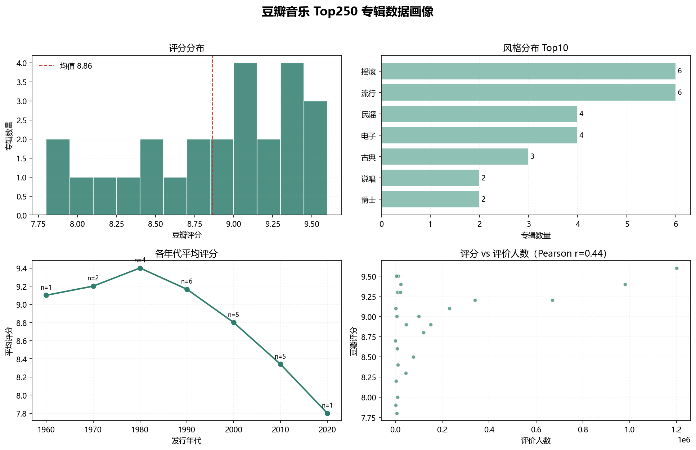
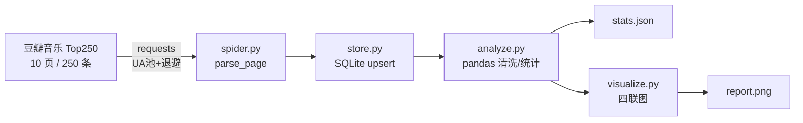

# 豆瓣音乐 Top250 数据采集与分析流水线

> 采集 → 清洗 → SQLite 落库 → 多维统计 → 四联可视化。解析层与网络层解耦，**内置 fixture 可离线复现全流程**。

[](https://www.python.org/)
[](https://pandas.pydata.org/)
[](#测试)
[](LICENSE)



---

## 这个项目解决什么问题

爬虫脚本很容易写成"一次性的"：解析逻辑和 `requests.get` 揉在一起、抓一半挂了要重头再来、结论只存在于某张截图里。

这个仓库把一次性的课程脚本重构成了一条**可复现的数据管道**：

| 问题 | 处理方式 |
|---|---|
| 解析逻辑无法测试 | `parse_page(html, offset)` 是纯函数，输入 HTML 输出 `list[dict]` |
| 断点续爬 & 重复抓取 | SQLite `rank` 主键 + `ON CONFLICT DO UPDATE`，幂等写入 |
| 抓取被限流 | UA 池轮换 + 5~8s 随机间隔 + 指数退避重试 + 页面有效性校验 |
| 数据口径不一 | `1.2万` / `45,678` / `暂无` 统一归一化为整数 |
| 分析结论散落 | 统计结果落 `stats.json`，图表落 PNG，可直接进报告 |

---

## 流水线结构



**模块职责**

| 文件 | 职责 |
|---|---|
| `src/config.py` | 反爬参数、UA 池、路径常量 |
| `src/spider.py` | `parse_votes` / `parse_page` / `fetch_page` / `crawl` |
| `src/store.py` | SQLite 建表、幂等 upsert、查询 |
| `src/analyze.py` | 清洗、去重、多维统计 |
| `src/visualize.py` | 评分分布 / 风格 Top10 / 年代趋势 / 相关性散点 |
| `src/main.py` | CLI 入口，串起全链路 |

---

## 快速开始

### 离线演示（不需要网络，30 秒出结果）

```bash
pip install -r requirements.txt

python -m tests.make_fixture     # 生成测试用 HTML fixture
python -m src.main --offline     # 跑通 采集→落库→分析→出图
```

输出：

```
[info] 本次写入 25 条，库内共 25 条
专辑数        : 25
平均评分      : 8.86
评分区间      : 7.8 ~ 9.6
评分-人气相关 : r = 0.44
风格 Top3     : [('摇滚', 6), ('流行', 6), ('民谣', 4)]
```

### 真实抓取

豆瓣未登录请求会被引导到验证页，需要先从浏览器复制 `bid` Cookie：

```bash
# Windows PowerShell
$env:DOUBAN_BID="你的bid值"
python -m src.main --pages 10
```

其它参数：

```bash
python -m src.main --pages 2 --db data/test.db --outdir output/
```

---

## 测试

```bash
python -m tests.test_offline
```

19 个用例全部离线运行，覆盖：

- `parse_votes`：`120万+` → 1200000、`1.2万` → 12000、`45,678` → 45678、`暂无` → 0
- `parse_page`：条目数、排名连续性、字段完整性、`offset` 排名偏移、`未知` 年份保留、多风格逗号保留
- `clean`：剔除 0 分、按 rank 去重
- `compute_stats`：指标齐全、均值合理、年代按 10 年分组
- `AlbumStore`：重复 upsert 不增行、同 rank 更新生效

> fixture 是**合成数据**（`示例专辑 No.xx`），只用于验证解析与管道正确性，不代表真实豆瓣榜单。

---

## 数据结构

`albums` 表：

| 字段 | 类型 | 说明 |
|---|---|---|
| `rank` | INTEGER PK | 排名 1–250，主键保证幂等 |
| `title` | TEXT | 专辑名 |
| `artist` | TEXT | 演唱者 |
| `year` | TEXT | 发行年份，缺失记为 `未知` |
| `genre` | TEXT | 风格，多风格用逗号分隔 |
| `rating` | REAL | 豆瓣评分 |
| `votes` | INTEGER | 评价人数（已归一化） |
| `crawled_at` | TEXT | 采集时间戳 |

索引：`rating`、`artist`。

---

## 分析指标

- 评分分布：均值 / 中位数 / 极值 / 直方图
- 风格结构：多标签拆分后的 Top10
- 年代趋势：按十年分组的样本量与平均分
- 相关性：评分与评价人数的 Pearson 系数
- 歌手集中度：上榜专辑数 Top10

---

## 已知限制

- **强依赖豆瓣页面结构**：`div.list-item` 等选择器一变就要改解析层（已隔离在 `parse_page` 内，改一处即可）
- **仅单机单线程**：未做并发抓取，250 条数据量下没有优化必要；要扩量需加线程池与请求队列
- **未处理验证码**：反爬升级后需要人工介入，不打算做绕过
- **合规**：仅抓取公开榜单用于学习分析，遵守 `robots.txt` 与低频访问

---

## License

[MIT](LICENSE) © 2026 Fang Yanbo